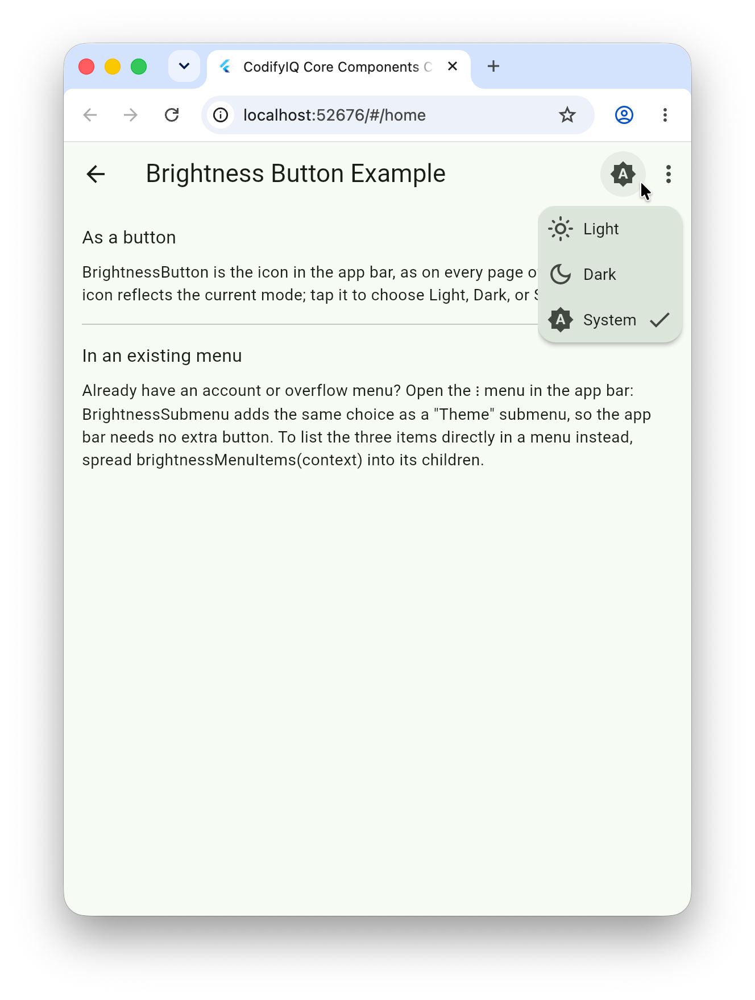

# codifyiq_brightness_button

[](https://pub.dev/packages/codifyiq_brightness_button)

A simple wrapper around [AdaptiveTheme](https://pub.dev/packages/adaptive_theme) to toggle
between Light, Dark, and System brightness modes. Drop it into an `AppBar` or settings screen,
or into a menu you already have.

## Demo
Select the image for a quick walkthrough:
<a href="https://drive.google.com/file/d/1zgx7vzw-D2P1gK0g49CdABa-TA0hjglJ/view?usp=drive_link"></a>

## Installation

```yaml
dependencies:
  codifyiq_brightness_button: ^2.0.0
```

## Usage

```dart
import 'package:codifyiq_brightness_button/codifyiq_brightness_button.dart';

AppBar(actions: const [BrightnessButton()]);
```

Already have an account or overflow menu? Add the choice as a submenu instead:

```dart
MenuAnchor(
  menuChildren: const [BrightnessSubmenu()],
  builder: (context, controller, child) => IconButton(
    icon: const Icon(Icons.account_circle),
    onPressed: controller.open,
  ),
);
```

Or spread the three items straight into the menu with
`...brightnessMenuItems(context)`. Every label can be overridden, e.g. for localization.

Your app must be wrapped in `AdaptiveTheme` (see the
[adaptive_theme setup](https://pub.dev/packages/adaptive_theme)) for the toggle to take effect.

---

Part of the [CodifyIQ component family](https://github.com/CodifyIQ/codifyiq-core-components) · [pub.dev/publishers/codifyiq.com](https://pub.dev/publishers/codifyiq.com)
